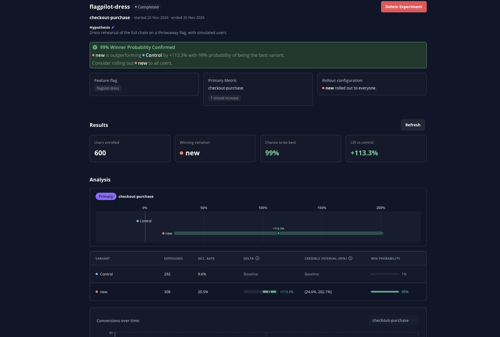
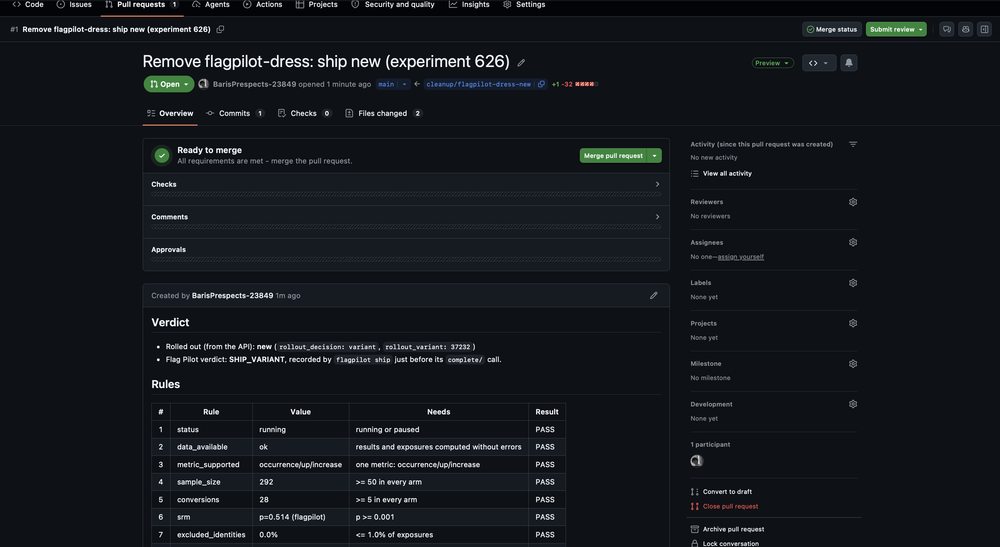
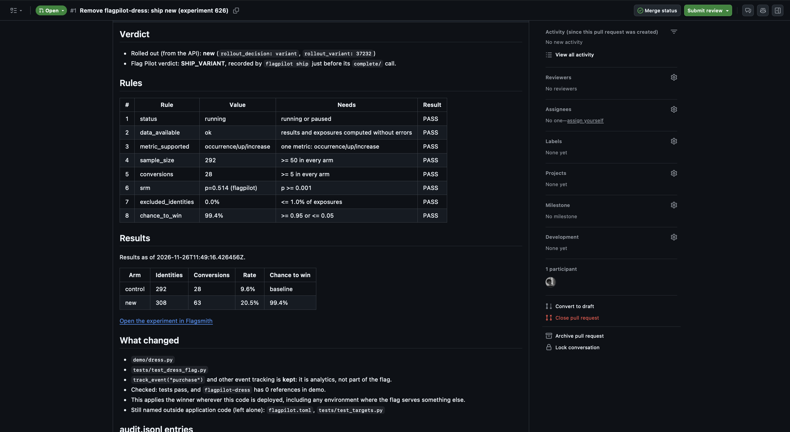
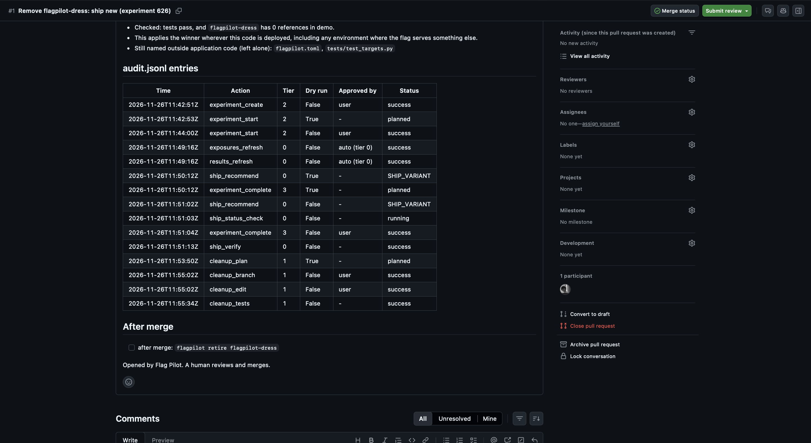
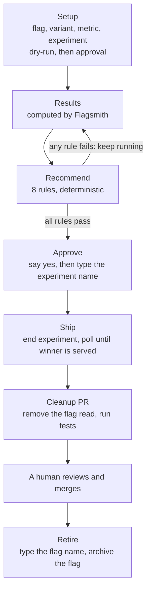

# Flag Pilot

**Experiments end, but the winner often isn't shipped cleanly, and stale flags and dead code pile
up.** Flag Pilot is for teams running Flagsmith experiments. It takes a finished experiment from
results to rollout to cleanup, and stops to ask a person before anything that matters.

It is a command-line tool, `flagpilot`, with an agent layer on top: two Claude Code slash commands,
`/ship-winner` and `/cleanup-flag`, that explain what the tool decided and relay your approval.

Built for Flagsmith Track 2, *AI Agents and Feature Flags*. Flagsmith's setup prompt gets an
experiment running; Flag Pilot takes it from there.

## Why it's new

In our smoke test, Flagsmith's `complete/` call ended an experiment that had **no data**: no
traffic and no computed results. The API doesn't check results before it ends an experiment and
rolls out a variant. Flag Pilot adds the checks:

- **8 fixed rules** decide the verdict. No LLM computes or changes it.
- **Its own sample-ratio-mismatch (SRM) check** when Flagsmith returns no p-value.
- **Typed approval:** shipping is irreversible, so you type the experiment's name.
- **A cleanup pull request that a human merges.** Flag Pilot never merges it.

## How Flagsmith is used

The flag serves the variants, the experiment measures them, and Flagsmith computes the results
that Flag Pilot acts on.

**CLI v2** (`flagsmith`)

| Command | Used for |
|---|---|
| `login`, `init` | Setup, run by you |
| `feature create <flag> --value control --enabled` | Create the flag |
| `feature variant add <flag> --value --key --weight 0` | Add the keyed variant |
| `feature get <flag>` | Read the default value and enabled state before cleanup |
| `evaluate <flag> --identity <id> --trait flagpilot_verify=1` | Confirm users get the winner |
| `feature update <flag> --archive` | Retire the flag |
| `api <path>` (`-X POST`, `--input -`, `--jq`) | Every endpoint below |

**REST API** (`E` = `api/v1/environments/<env_key>`)

| Method and endpoint | Used for |
|---|---|
| `GET api/v1/projects/<project id>/features/?search=<flag>` | Find the flag, check whether it is archived |
| `GET`, `POST E/experiment-metrics/` | Find or create the conversion metric |
| `GET`, `POST E/experiments/` | List or create experiments |
| `GET E/experiments/<id>/` | Status, variants and rollout decision |
| `GET E/warehouse-connections/` | Refuse to start without a warehouse |
| `POST E/experiments/<id>/start/` | Start the experiment |
| `GET E/experiments/<id>/exposures/`, `POST …/exposures/refresh/` | Identities per arm |
| `GET E/experiments/<id>/results/`, `POST …/results/refresh/` | Chance to win, lift, conversions |
| `POST E/experiments/<id>/complete/` | End the experiment and roll out the winner |

**Python SDK** (demo shop, [`demo/app.py`](demo/app.py))

| Call | Used for |
|---|---|
| `Flagsmith(environment_key=..., enable_events=True, default_flag_handler=...)` | Client with events, and a `control` fallback if Flagsmith is unreachable |
| `get_experiment_flag("checkout_button", identifier=user_id)` | Serve the variant and record the exposure |
| `track_event("purchase", identifier=user_id)` | Record the conversion |
| `close()` | Send buffered events at shutdown |

The simulator also calls `flush_events()`. The MCP server isn't used for experiments, because it
can't start them.

## Time saved

| Step | By hand | With Flag Pilot |
|---|---|---|
| 1. Dashboard review | Read the numbers, judge sample size and traffic split | `/ship-winner <id>`: one card with all 8 rules |
| 2. End the experiment | End it in the dashboard | Same command: say yes, then type the name |
| 3. Roll out | Pick the winner, check that users get it | Same command: it polls 10 identities |
| 4. Edit the code | Find each flag read, delete the losing path, fix tests | `/cleanup-flag <id>`: say yes |
| 5. Open a pull request | Write it up with the evidence | Same command |
| Merge | You review and merge | You review and merge |
| 6. Archive the flag | Remember to do it | `flagpilot retire <flag> --apply`: type the flag name |

Six manual steps become two slash commands, your merge and `retire`. In the dress rehearsal,
verifying the rollout took 9 seconds and going from cleanup branch to open pull request took 38.
We haven't timed the manual route.

## Proof

The dress rehearsal ran the whole chain on a throwaway flag in Flagsmith Cloud. **The users were
simulated;** Flagsmith assigned the arms and computed the results.

- Experiment `626`: `control` 28 of 292 (9.6%), `new` 63 of 308 (20.5%), 99.4% chance to win.
  These numbers matched the Flagsmith dashboard.

  
  *Flagsmith dashboard for the rehearsal experiment: Completed, new rolled out to everyone, 99% chance to win, 292/308 exposures.*

- Shipped after the typed name; 10 of 10 sample identities got `new`.
- [PR #1](https://github.com/BarisPrespects-23849/flag-pilot/pull/1), the cleanup pull request,
  was opened by Flag Pilot and **merged by a human**. The flag was then archived with `retire`.

The next three screenshots show PR #1 before it was merged.


*The cleanup pull request, waiting for a person to merge it.*


*The evidence travels with the code: all 8 rules, the results and what changed.*


*The audit trail of approvals and calls, and the next step after merging.*

## Lifecycle



## Track 2 criteria

| Criterion | How Flag Pilot earns it |
|---|---|
| Flagsmith CLI, API or MCP server | CLI v2, the REST API and the Python SDK: see [How Flagsmith is used](#how-flagsmith-is-used) |
| Saves real time | Two slash commands replace the review, rollout, code edit and pull request: see [Time saved](#time-saved) |
| A human approves changes | Tiered gates. Shipping needs the typed experiment name, archiving needs the typed flag name, and merging is yours. |
| Clear output | One decision card: verdict, per-arm numbers, every rule with pass or fail, and the exact call that would run. |

Token use: Flag Pilot's own code makes no LLM calls. Claude Code explains the decision or the diff,
relays your approval and, only when the code needs it, writes a patch that `cleanup` verifies.
`/cost` shows the session's usage.

## Autonomy matrix: what it does alone and where it stops

| Tier | Actions | Where it stops | In the code today |
|---|---|---|---|
| **0 Read** | read experiment, exposures, results; refresh them | Runs on its own | `recommend`; `--refresh` is auto-approved and logged |
| **1 Reversible, nothing new served** | create flag (serves `control`), add variant at 0%, create metric, push a cleanup branch and open its PR | Dry-run, then approval | `--apply --approved-by NAME`; `cleanup --apply` |
| **2 Changes what users see or what is measured** | create experiment, start it, send simulated traffic | Dry-run, then approval | `--apply --approved-by NAME`. Pause and rollout edits are not implemented. |
| **3 Irreversible or retiring** | end the experiment and ship the winner; archive a flag | Plan and typed name; refused if any check fails | `ship`, `retire`. Archiving can be undone; flag deletion is not implemented. |
| **Never** | print the auth token, edit a running flag, auto-merge a PR, delete a metric in use | Not offered | Not implemented |

Creating an experiment serves its 50/50 split **immediately**, before it is started. That is why it
is Tier 2.

## The 8 ship rules

All must pass. Thresholds are in [`flagpilot.toml`](flagpilot.toml).

| # | Rule | Needs |
|---|---|---|
| 1 | `status` | running or paused |
| 2 | `data_available` | results and exposures computed without errors |
| 3 | `metric_supported` | exactly one metric: occurrence / up / increase |
| 4 | `sample_size` | at least 50 identities in every arm |
| 5 | `conversions` | at least 5 conversions in every arm |
| 6 | `srm` | sample-ratio-mismatch p-value of at least 0.001 |
| 7 | `excluded_identities` | at most 1% of exposures |
| 8 | `chance_to_win` | at least 95% (ship the variant) or at most 5% for every variant (ship control) |

## Cleanup and retire

`cleanup <experiment id>` refuses unless the experiment is `completed`, and takes the winner from
the API (`rollout_decision`, `rollout_variant`).

- Finds reads with Python's `ast` (`get_experiment_flag`, `get_flag`, `get_feature_value`,
  `is_feature_enabled`), flag-name literals and constants, and cross-checks with `git grep`.
- Rewrites a read that feeds an `if`, keeping the winner's path. Anything else is reported as
  needing a manual edit, supplied with `--patch`.
- `--apply` works in a temporary git worktree from `origin/main`. It pushes only if just the listed
  files changed, 0 references remain, event tracking such as `track_event("purchase")` is still
  there and the tests pass.
- Opens the PR with the verdict, rules, results, dashboard link and audit entries. Never merges.
- Delete flag-only tests by marking their file `pytestmark = pytest.mark.flag("<flag>")`.
- `--assume-winner <key>` previews the diff before completion. Dry-run only.

`retire <flag>` archives (never deletes). It refuses unless every experiment on the flag is
`completed`, the cleanup PR is merged into `main`, and `origin/main` has 0 references. `--no-code`
skips only the PR check, for flags that never had application code.

`retire` archives the flag (hidden in the dashboard); archived flags still evaluate, which is safe
once cleanup has removed every application code read.

"References" means application code (`app_paths` in `flagpilot.toml`, here `demo/`) and test files
marked for the flag. Mentions in tooling, docs and fixtures are listed and left alone.

## Safety rules

- **Dry-run by default.** Provisioning, start, simulator, `ship`, `cleanup` and `retire` change nothing without `--apply`.
- **Typed-name approval.** `ship --apply` asks for the experiment name, or takes `--confirm "<name>"`.
- **Two human checks.** Irreversible commands need a human twice: Flag Pilot's typed-name check, and a Claude Code permission prompt on `--apply` that auto mode can't skip (`.claude/settings.json`). Direct write calls through the Flagsmith CLI also prompt, and so do edits to these settings. The rules match command text and file paths, so they cover the usual invocations, not a disguised command or another tool such as `curl`. Running `flagpilot` directly in your own terminal is your own approval.
- **`--expect-winner`.** Required with `--confirm`. If the winner changed since the dry-run, `ship` refuses.
- **Fresh checks.** `ship` recomputes the verdict, then rereads the status just before the call.
- **Verified rollout.** It polls 10 sample identities until all get the winner and the experiment is `completed`; otherwise it reports `NOT VERIFIED`.
- **`audit.jsonl`.** Plans, calls, refusals and verification are appended with tier, dry-run flag, approver, status and a body hash. Git-ignored.
- **Own SRM check.** When Flagsmith returns no SRM p-value, Flag Pilot computes a chi-square test from the exposure counts. The card shows which source was used.
- **Secrets** live only in `.env`, which is git-ignored. Environment keys are redacted in logged paths.

## Quickstart

Tested on macOS (Apple silicon) with uv 0.5.26, git 2.30.1 and Flagsmith CLI 2.0.0.

You need:

- git and [uv](https://docs.astral.sh/uv/). The project uses Python 3.12.
- Flagsmith CLI v2: `curl -fsSL https://get.flagsmith.com | sh` (installs to `~/.local/bin`; check
  that it is on your `PATH`).
- For the live flow: a Flagsmith project with experimentation and a warehouse connection (we used
  Flagsmith's managed warehouse).
- For `cleanup` and `retire`: the GitHub CLI (`gh auth login`) and your own fork.
- Optional: Claude Code, for `/ship-winner` and `/cleanup-flag`.

### Install and test (no Flagsmith account needed)

```bash
git clone https://github.com/BarisPrespects-23849/flag-pilot
cd flag-pilot
uv sync
uv run pytest
uv run flagpilot --help
```

To run `cleanup`, use a fork instead of the clone above:

```bash
gh repo fork BarisPrespects-23849/flag-pilot --clone
cd flag-pilot
gh repo set-default <your-user>/flag-pilot
```

### Connect your Flagsmith project

```bash
flagsmith login          # opens a browser; --no-browser prints the URL
flagsmith init           # pick your project and Development environment
cp -n .env.example .env
```

Don't skip `init`: the committed `flagsmith.json` points to our project. In `.env`, set
`FLAGSMITH_SERVER_KEY` to a server-side key (`ser.…`) from **SDK Keys** in the same environment.
Only the simulator and demo shop use it.

### Run an experiment

Set up an experiment. Each command is a dry-run; repeat it with `--apply --approved-by NAME` to
run it, one step at a time and in this order. Dry-run and apply each step before the next; later
steps are blocked until earlier ones exist.

```bash
uv run python -m flagpilot.provision flag       --target checkout
uv run python -m flagpilot.provision variant    --target checkout
uv run python -m flagpilot.provision metric     --target checkout
uv run python -m flagpilot.provision experiment --target checkout
uv run python -m flagpilot.lifecycle start      --target checkout
uv run python -m flagpilot.simulate             --target checkout --users 600
```

Wait a few minutes before `recommend --refresh`. A new warehouse can take hours to show its first
events. `KEEP_RUNNING` means a rule hasn't passed yet.

Then decide and ship, using the experiment id printed when it was created:

```bash
uv run flagpilot recommend <id> --refresh   # recompute, then show the decision card
uv run flagpilot ship <id>                  # dry-run
uv run flagpilot ship <id> --apply          # irreversible; asks for the experiment name
```

Then remove the flag:

```bash
uv run flagpilot cleanup <id>                  # dry-run: call sites and diff
uv run flagpilot cleanup <id> --apply          # branch, tests, push, pull request
# review and merge the pull request yourself
uv run flagpilot retire <flag>                 # dry-run
uv run flagpilot retire <flag> --apply         # asks for the flag name
```

Or, in Claude Code: `/ship-winner <id>`, then `/cleanup-flag <id>`.

`cleanup` and `retire` use the GitHub CLI (`gh auth login`) and an `origin` remote.

Demo shop: `uv run uvicorn demo.app:app --port 8800`, then open
`http://127.0.0.1:8800/?user_id=alice`. A visit records a real exposure if the experiment is running.
It needs the server key, and it reads `checkout_button` only until that flag's cleanup PR is merged.

## Known limits

- **The default value stays `control` until cleanup.** After shipping, identified users get the winner; requests without an identity still get `control`, until the cleanup PR is merged and deployed.
- **Cleanup applies the winner everywhere** the code runs, including an environment where the flag still serves something else.
- **The cleanup PR doesn't flag simulated traffic.** Its audit table leaves out the simulator run.
- **Manual edits are lightly tested.** `cleanup --patch` has run only on a throwaway local repository with GitHub faked.
- **Narrow rewriter.** It handles Python reads that feed an `if`. It can leave unused parameters or helpers behind.
- **One repository.** `cleanup` and `retire` can't see other services that read the flag.
- **Archiving doesn't stop evaluation.** About a minute after archiving, `flagsmith evaluate` still returned the archived flags' values.
- **One environment.** `retire` checks experiments in the environment in `flagsmith.json`, but archiving affects the whole project.
- **Traffic is simulated.** The users and purchase rates are invented in `flagpilot/simulate.py`. Flagsmith assigns arms and computes the results.
- **Rate limits.** Results can be refreshed once every 5 minutes, and exposure refresh is limited too. `recommend --refresh` skips a limited step and shows the existing data.
- **One metric shape.** Anything other than a single occurrence / up / increase metric is reported as `KEEP_RUNNING`.
- **Shipping `control` is untested.** Only the variant decision has been run against Flagsmith.
- **Undocumented endpoint.** `complete/` is in Flagsmith's API spec but not its docs.
- **Verification is a sample.** 10 identities, in the one environment in `flagsmith.json`. Rollout took about 15 seconds in the smoke test.
- **One metric for provisioning.** Every target shares one `purchase` metric. `checkout` and `rehearsal` are set in `flagpilot/config.py`; more targets go in `flagpilot.toml` under `[targets.<name>]`.
- **The demo flag gets cleaned up.** After the demo, the checkout_button cleanup PR will be merged, so demo/app.py will no longer read the flag. The rehearsal (flagpilot-dress, PR #1) shows the full flow; to try it yourself, use your own flag and a `--target` in flagpilot.toml.

## More

- [`docs/DEMO.md`](docs/DEMO.md): the 2-minute demo script.
- [`NOTES.md`](NOTES.md): verified commands, endpoints, payloads and constraints.
