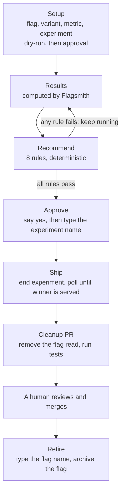

# Flag Pilot

**Flagsmith's setup prompt gets an experiment running. Flag Pilot takes it from there.**

It reads the real results, explains them in plain English, asks a human, ships the winner and
checks that users actually get it. Then it opens a pull request that removes the dead code, and
archives the flag once a human has merged it.

Built for Flagsmith Track 2, *AI Agents and Feature Flags*.

- **Code decides.** Eight fixed rules produce the verdict. No LLM computes or changes it.
- **A human approves.** Shipping is irreversible, so you type the experiment's name.
- **Tried for real.** `ship --apply` ran end to end on a throwaway experiment in Flagsmith Cloud:
  10 of 10 sample identities got the winner 7 seconds after the call. The users were simulated.
  `retire --apply` archived two throwaway flags. `cleanup` has run as a dry-run on the real
  experiment; opening a real pull request has not been tried yet.

## Lifecycle



## Track 2 criteria

| Criterion | How Flag Pilot earns it |
|---|---|
| CLI / API / MCP use | Flagsmith CLI v2, the Experiments, Metrics, Results and Exposures APIs, and the Python SDK with events. MCP is not used for experiments because it can't start them. |
| Saves time | Reading results, deciding and rolling out is one command (`/ship-winner <id>`) and two replies. `/cleanup-flag <id>` turns the result into a pull request. |
| Human approves changes | Tiered gates. Shipping needs the typed experiment name, archiving needs the typed flag name, and merging is yours. |
| Clear output | One decision card: verdict, per-arm numbers, every rule with pass or fail, and the exact call that would run. |

Token use: Flag Pilot's own code makes no LLM calls. Claude Code explains the decision or the diff,
relays your approval and, only when the code needs it, writes a patch that `cleanup` verifies.
`/cost` shows the session's usage.

## Autonomy matrix: what it does alone and where it stops

| Tier | Actions | Where it stops | In the code today |
|---|---|---|---|
| **0 Read** | read experiment, exposures, results; refresh them | Runs on its own | `recommend`; `--refresh` is auto-approved and logged |
| **1 Reversible, nothing new served** | create flag (serves `control`), add variant at 0%, create metric, push a cleanup branch and open its PR | Dry-run, then approval | `--apply --approved-by NAME`; `cleanup --apply` |
| **2 Changes what users see or what is measured** | create experiment, start it, send simulated traffic | Dry-run, then approval | `--apply --approved-by NAME`. Pause and rollout edits are not implemented. |
| **3 Irreversible or retiring** | end the experiment and ship the winner; archive a flag | Plan and typed name; refused if any check fails | `ship`, `retire`. Archiving can be undone; flag deletion is not implemented. |
| **Never** | print the auth token, edit a running flag, auto-merge a PR, delete a metric in use | Not offered | Not implemented |

Creating an experiment serves its 50/50 split **immediately**, before it is started. That is why it
is Tier 2.

## The 8 ship rules

All must pass. Thresholds are in [`flagpilot.toml`](flagpilot.toml).

| # | Rule | Needs |
|---|---|---|
| 1 | `status` | running or paused |
| 2 | `data_available` | results and exposures computed without errors |
| 3 | `metric_supported` | exactly one metric: occurrence / up / increase |
| 4 | `sample_size` | at least 50 identities in every arm |
| 5 | `conversions` | at least 5 conversions in every arm |
| 6 | `srm` | sample-ratio-mismatch p-value of at least 0.001 |
| 7 | `excluded_identities` | at most 1% of exposures |
| 8 | `chance_to_win` | at least 95% (ship the variant) or at most 5% for every variant (ship control) |

## Cleanup and retire

`cleanup <experiment id>` refuses unless the experiment is `completed`, and takes the winner from
the API (`rollout_decision`, `rollout_variant`).

- Finds reads with Python's `ast` (`get_experiment_flag`, `get_flag`, `get_feature_value`,
  `is_feature_enabled`), flag-name literals and constants, and cross-checks with `git grep`.
- Rewrites a read that feeds an `if`, keeping the winner's path. Anything else is reported as
  needing a manual edit, supplied with `--patch`.
- `--apply` works in a temporary git worktree from `origin/main`. It pushes only if just the listed
  files changed, 0 references remain, event tracking such as `track_event("purchase")` is still
  there and the tests pass.
- Opens the PR with the verdict, rules, results, dashboard link and audit entries. Never merges.
- Delete flag-only tests by marking their file `pytestmark = pytest.mark.flag("<flag>")`.
- `--assume-winner <key>` previews the diff before completion. Dry-run only.

`retire <flag>` archives (never deletes). It refuses unless every experiment on the flag is
`completed`, the cleanup PR is merged into `main`, and `origin/main` has 0 references. `--no-code`
skips only the PR check, for flags that never had application code.

`retire` archives the flag (hidden in the dashboard); archived flags still evaluate, which is safe
because cleanup already removed every code read.

"References" means application code (`app_paths` in `flagpilot.toml`, here `demo/`) and test files
marked for the flag. Mentions in tooling, docs and fixtures are listed and left alone.

## Safety rules

- **Dry-run by default.** Provisioning, start, simulator, `ship`, `cleanup` and `retire` change nothing without `--apply`.
- **Typed-name approval.** `ship --apply` asks for the experiment name, or takes `--confirm "<name>"`.
- **`--expect-winner`.** Required with `--confirm`. If the winner changed since the dry-run, `ship` refuses.
- **Fresh checks.** `ship` recomputes the verdict, then rereads the status just before the call.
- **Verified rollout.** It polls 10 sample identities until all get the winner and the experiment is `completed`; otherwise it reports `NOT VERIFIED`.
- **`audit.jsonl`.** Plans, calls, refusals and verification are appended with tier, dry-run flag, approver, status and a body hash. Git-ignored.
- **Own SRM check.** When Flagsmith returns no SRM p-value, Flag Pilot computes a chi-square test from the exposure counts. The card shows which source was used.
- **Secrets** live only in `.env`, which is git-ignored. Environment keys are redacted in logged paths.

Why this matters: Flagsmith's `complete/` call accepted an experiment with no traffic and no
results refresh in our smoke test, so these rules are the safety net.

## Quickstart

You need [uv](https://docs.astral.sh/uv/), Flagsmith CLI v2 (from `get.flagsmith.com`; tested with
2.0.0), a Flagsmith project with experimentation and a warehouse connection, and Claude Code for
`/ship-winner`.

```bash
uv sync
flagsmith login
flagsmith init                 # writes flagsmith.json; replaces this repo's project binding
cp -n .env.example .env        # then add your server-side SDK key
uv run pytest
```

Set up an experiment. Each command is a dry-run; repeat it with `--apply --approved-by NAME` to
run it, one step at a time and in this order:

```bash
uv run python -m flagpilot.provision flag       --target checkout
uv run python -m flagpilot.provision variant    --target checkout
uv run python -m flagpilot.provision metric     --target checkout
uv run python -m flagpilot.provision experiment --target checkout
uv run python -m flagpilot.lifecycle start      --target checkout
uv run python -m flagpilot.simulate             --target checkout --users 600
```

Then decide and ship, using the experiment id printed when it was created:

```bash
uv run flagpilot recommend <id> --refresh   # recompute, then show the decision card
uv run flagpilot ship <id>                  # dry-run
uv run flagpilot ship <id> --apply          # irreversible; asks for the experiment name
```

Then remove the flag:

```bash
uv run flagpilot cleanup <id>                  # dry-run: call sites and diff
uv run flagpilot cleanup <id> --apply          # branch, tests, push, pull request
# review and merge the pull request yourself
uv run flagpilot retire <flag>                 # dry-run
uv run flagpilot retire <flag> --apply         # asks for the flag name
```

Or, in Claude Code: `/ship-winner <id>`, then `/cleanup-flag <id>`.

`cleanup` and `retire` use the GitHub CLI (`gh auth login`) and an `origin` remote.

Demo shop: `uv run uvicorn demo.app:app --port 8800`, then open
`http://127.0.0.1:8800/?user_id=alice`. A visit records a real exposure if the experiment is running.

## Known limits

- **The default value stays `control` until cleanup.** After shipping, identified users get the winner; requests without an identity still get `control`, until the cleanup PR is merged and deployed.
- **Cleanup applies the winner everywhere** the code runs, including an environment where the flag still serves something else.
- **Cleanup's PR step is untested against GitHub.** `--apply` has run only on a throwaway local repository with GitHub faked.
- **Narrow rewriter.** It handles Python reads that feed an `if`. It can leave unused parameters or helpers behind.
- **One repository.** `cleanup` and `retire` can't see other services that read the flag.
- **Archiving doesn't stop evaluation.** About a minute after archiving, `flagsmith evaluate` still returned both flags' values.
- **One environment.** `retire` checks experiments in the environment in `flagsmith.json`, but archiving affects the whole project.
- **Traffic is simulated.** The users and purchase rates are invented in `flagpilot/simulate.py`. Flagsmith assigns arms and computes the results.
- **Rate limits.** Results can be refreshed once every 5 minutes, and exposure refresh is limited too. `recommend --refresh` skips a limited step and shows the existing data.
- **One metric shape.** Anything other than a single occurrence / up / increase metric is reported as `KEEP_RUNNING`.
- **Shipping `control` is untested.** Only the variant decision has been run against Flagsmith.
- **Undocumented endpoint.** `complete/` is in Flagsmith's API spec but not its docs.
- **Typed name is a string check.** The code can't tell who typed `--confirm`. `/ship-winner` instructs the agent to pass only your own reply.
- **Verification is a sample.** 10 identities, in the one environment in `flagsmith.json`. Rollout took about 15 seconds in the smoke test.
- **Fixed names.** Flag, metric and experiment names for provisioning are set in `flagpilot/config.py`.

## More

- [`docs/DEMO.md`](docs/DEMO.md): the 2-minute demo script.
- [`NOTES.md`](NOTES.md): verified commands, endpoints, payloads and constraints.
